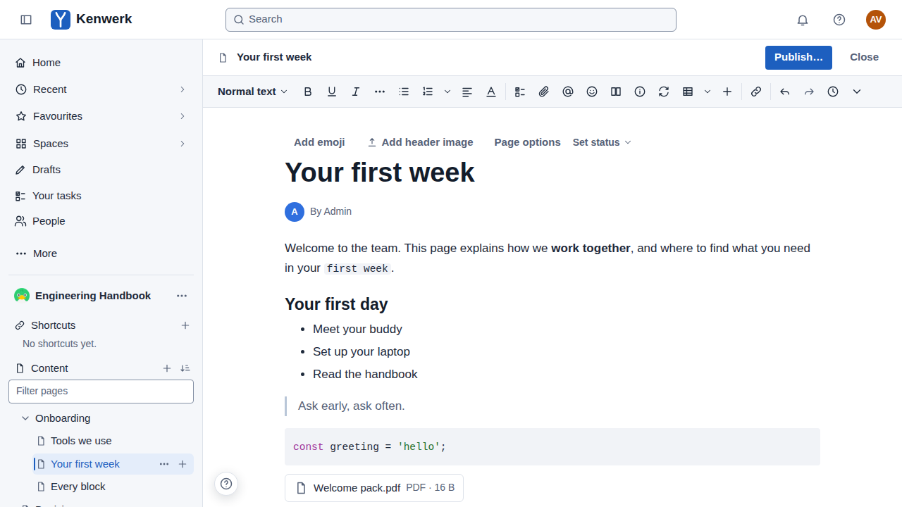
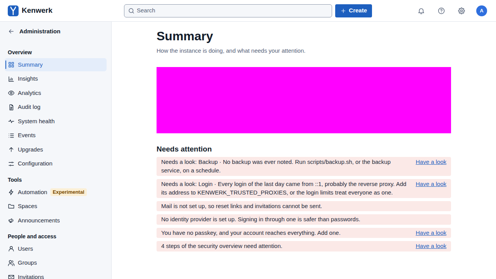

# Kenwerk

**An open-source, self-hosted knowledge platform. Secure by default, boring to operate, painless to upgrade.**

> Status: **alpha**. Phases 1 and 2 of the [roadmap](docs/blueprint/08-roadmap.md) are built and waiting for acceptance testing. Nothing is supported before 1.0.
>
> **What it is sized for:** one node, a few hundred people, measured on your own hardware. Several nodes are not proven yet. What was measured, and where it gave way, is in [the known limits](docs/operations/limits.md) and the stress tests of [10 November](docs/reports/2026-11-10-stress-test.md) and [12 November](docs/reports/2026-11-12-stress-test-2.md).
>
> **Experimental parts** are off on a new installation, and an administrator turns each on under Administration, Organising: automation rules, databases, bundles between instances, restore from the console, draft and published spaces, and guided templates. Public sites and analytics are experimental too, with their own switches, which also start off ([ADR-043](docs/blueprint/10-decision-log.md)).

Kenwerk is a team wiki with spaces, pages and enterprise-grade permissions, licensed under Apache 2.0. You run it yourself, on one machine, with Docker. The plan and every design decision live in [`docs/blueprint/`](docs/blueprint/00-README.md).

| A page | Writing |
|---|---|
|  |  |
| **Search** | **Administration** |
|  |  |

The pictures are the design tests themselves: every screen of the product is photographed by its browser tests on each change, so they show the product as it is now.

## What it does

- **Write together.** Spaces and a page tree, a visual editor with Markdown shortcuts, tables, tasks, mentions and comments, drafts and version history with compare and restore, templates and attachments.
- **Find things.** Full-text search over pages, comments, tasks, people and spaces, with filters, and a search box that is always one key away.
- **Keep it safe.** Roles, groups, guests and page restrictions, with a "why can or can't they?" view. Local accounts with an authenticator app or passkeys, OIDC login and SCIM provisioning. A tamper-evident audit log, and every settings change recorded with what changed.
- **Run it calmly.** One binary and PostgreSQL. Backups, restore from the console, health checks and upgrades that refuse to run without a recent backup.
- **Automate it.** Every feature is reachable through the REST API ([`docs/api/`](docs/api/)), so scripts and AI assistants can do what a person can. Automation rules and webhooks are built in.

| Notifications | Dark |
|---|---|
|  |  |

## Try it

Needs Docker with the Compose plugin.

```sh
sh scripts/setup-secrets.sh
docker compose up -d --build --wait
docker compose logs kenwerk | grep 'first setup'
```

Then open http://localhost:8080/setup and enter the setup code from that log line. The setup screen asks for the name of your company or your own name, which the search box shows as "Search in Your team", and makes you the first administrator. The code works once, for an hour; `docker compose exec kenwerk kenwerk setup-code` gives a new one. You can also make the first administrator on the command line:

```sh
printf '%s\n' 'a long password' | docker compose exec -T kenwerk kenwerk user create-admin --email you@example.com --name "You" --organisation "Your team"
```

For a real installation, read [the install guide](docs/operations/install.md).

## Deploy

> The buttons and modules pull the released images and chart from ghcr.io, so **they work from the first release on**. None is published yet. Every template is checked in CI, but none has been run on a cloud yet: try it in a scratch account first ([spec 099](docs/specs/099-deploy-anywhere.md)).

| Where | How | What you get |
|---|---|---|
| **Azure** | [](https://portal.azure.com/#create/Microsoft.Template/uri/https%3A%2F%2Fraw.githubusercontent.com%2FDr1nS0menOp%2FKenwerk%2Fmain%2Fdeploy%2Fazure%2Fazuredeploy.json) | Container Apps, PostgreSQL flexible server on a private network, Azure Files, backups every 4 hours, https on an Azure address. [Guide](docs/operations/deploy-azure.md) |
| **Google Cloud** | [](https://shell.cloud.google.com/cloudshell/editor?cloudshell_git_repo=https%3A%2F%2Fgithub.com%2FDr1nS0menOp%2FKenwerk&cloudshell_workspace=deploy%2Fterraform%2Fexamples%2Fgoogle-cloud&cloudshell_tutorial=tutorial.md) | GKE Autopilot, Cloud SQL on a private address, a managed certificate for your domain. [Guide](docs/operations/deploy-google-cloud.md) |
| **AWS** | `aws cloudformation deploy --stack-name kenwerk --template-file deploy/aws/kenwerk.yaml --capabilities CAPABILITY_IAM --parameter-overrides KenwerkVersion=v0.1.0` | ECS on Fargate, RDS for PostgreSQL, EFS, backups every 4 hours, https through CloudFront or your own domain. [Guide](docs/operations/deploy-aws.md) |
| **Terraform / OpenTofu** | `module "kenwerk" { source = "github.com/Dr1nS0menOp/Kenwerk//deploy/terraform/modules/kenwerk" ... }` | Kenwerk on any Kubernetes cluster against your PostgreSQL, with the secrets generated. [Guide](docs/operations/deploy-kubernetes.md#the-terraform-and-opentofu-module) |
| **Helm** | `helm install wiki oci://ghcr.io/dr1ns0menop/charts/kenwerk --version 0.1.0 --set publicUrl=https://wiki.example.com` | The chart, signed, from its OCI repository. [Guide](docs/operations/deploy-kubernetes.md) |
| **Docker Compose** | `sh scripts/setup-secrets.sh && docker compose up -d --wait` | The reference installation on one machine. [Guide](docs/operations/install.md) |
| **Debian, Ubuntu, Fedora, RHEL** | `.deb` and `.rpm` of each release, with a systemd unit | [Guide](docs/operations/install.md#packages-deb-and-rpm) |

Each runs one node, as Kenwerk is sized for, and generates its own passwords: no template holds a secret.

## Documentation

| | |
|---|---|
| [Install](docs/operations/install.md) | Docker Compose and LXC |
| Deploy on [Azure](docs/operations/deploy-azure.md), [AWS](docs/operations/deploy-aws.md), [Google Cloud](docs/operations/deploy-google-cloud.md), [Kubernetes](docs/operations/deploy-kubernetes.md) | Buttons, templates, the Helm chart and the Terraform module |
| [Upgrade](docs/operations/upgrade.md) | One command, no downtime |
| [Backup and restore](docs/operations/backup-restore.md) | With a drill that proves it works |
| [Identity providers](docs/operations/identity-providers.md) | Authentik, Entra ID, others |
| [Beta criteria](docs/beta-criteria.md) | What must hold before a release is called beta, and what holds today |
| [Promises for 1.0](docs/promises.md) | What is frozen, how it may change, upgrades, security fixes and support |
| [Development](docs/development.md) | Everything runs in containers |
| [How Kenwerk is tested](docs/testing.md) | Every check, when it runs, the counts, and what is not tested yet |
| [Threat model](docs/security/threat-model.md) | What we defend against, and how we know |
| [Routes](docs/api/routes.txt) | Every API route and its access rule |

## Commands

| Command | What it does |
|---|---|
| `kenwerk serve` | Runs the server. `KENWERK_ROLE` = `all` (default), `api` or `worker`. |
| `kenwerk migrate` | Applies pending *expand* migrations, after asking for a recent backup; `--without-backup` goes on once without one, recorded in the audit log |
| `kenwerk user create-admin` | Creates a local administrator account |
| `kenwerk setup-code` | Prints a new one-time code for the setup screen of a new install |
| `kenwerk audit verify` | Verifies the audit log hash chain |
| `kenwerk key <step>` | Checks or replaces `master.key` while Kenwerk runs; see [backup and restore](docs/operations/backup-restore.md#replace-it) |
| `kenwerk session end` | Logs one person (`--email`) or everyone (`--all`) out, without disabling anyone; see [incidents](docs/operations/incidents.md) |
| `kenwerk healthcheck` | Asks a running server whether it is ready |
| `kenwerk version` | Prints the version |

## Configuration

All settings come from environment variables. Any variable can instead be read from a file by appending `_FILE`, for example `KENWERK_DATABASE_URL_FILE=/run/secrets/db_url`. See [`.env.example`](.env.example).

## Contributing

Read [CONTRIBUTING.md](CONTRIBUTING.md). Every commit needs a DCO sign-off (`git commit -s`), and the clean-room rules are mandatory.

## Security

Kenwerk comes without guarantee, and security updates are not guaranteed. Read [the security risks](docs/security/risks.md) before you use it.

Please report vulnerabilities privately. See [SECURITY.md](SECURITY.md).

## Contact

Mail [KenwerkCreator@protonmail.com](mailto:KenwerkCreator@protonmail.com). The author is Dutch and prefers to stay anonymous.

## Licence

[Apache License 2.0](LICENSE)
